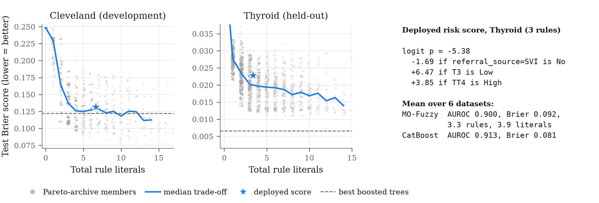

# ParetoFuzzy-ClinicalRisk

*Pareto-Optimal Calibrated and Interpretable Fuzzy Risk Scoring via Multi-Objective Evolutionary Optimization (NSGA-II)*

[](https://www.python.org/downloads/release/python-3110/)
[](LICENSE)
[](#citation)
[](#reproducibility-and-audit)

**Authors**

- **Zain Alabidin Shbani** (corresponding author): Université Clermont Auvergne, France
- **Beilassan Hdewa**: SUPMICROTECH-ENSMM, France · ORCID [0009-0003-4090-6675](https://orcid.org/0009-0003-4090-6675)

> **Disclaimer.** This is research software. It is **not a medical device** and must not be
> used for diagnosis, treatment or any other clinical decision.

## Overview

Clinical risk scores must **discriminate**, be **calibrated** and be **interpretable**.
Genetic-fuzzy models for health risk are usually optimised for accuracy alone, and they are
rarely compared with tuned gradient-boosted trees.

This repository contains a zero-order Takagi–Sugeno **additive fuzzy risk score**:

```text
logit p(x) = w0 + Σ_r w_r · β_r(x)
```

Here β_r(x) is the firing strength of a linguistic rule such as
*IF T3 is Low AND TT4 is High*. The linguistic partitions and the rule base are evolved by
**NSGA-II** for three objectives:

1. **Discrimination:** 1 − AUROC.
2. **Calibration:** Brier score, a strictly proper scoring rule.
3. **Interpretability:** total number of rule literals.

The rule weights are fitted by L2-penalised logistic regression, with the penalty chosen by
inner cross-validation. An external Pareto archive keeps every non-dominated model. A
preregistered ε-compact rule then picks one deployable model.

The method was evaluated in a **preregistered, leakage-free** benchmark:

- **Design:** 5 seeds × 5-fold outer CV with nested tuning.
- **Data:** 6 public clinical datasets (2 development, 4 held-out).
- **Models:** 11, including tuned XGBoost, LightGBM, CatBoost, post-hoc Platt and isotonic
  calibration, and single-objective GA-fuzzy baselines.
- **Scale:** 1,650 fits.

<p align="center">
  
</p>

## Key results

The table gives means over the 6 datasets; each dataset value is itself a mean over 25
outer test folds. Ranks are Friedman average ranks over the 11 preregistered models (1 = best).
All numbers come from `results/final/summary_by_dataset.csv` and `results/final/stats.json`.

| Model | AUROC ↑ | Brier ↓ | ECE ↓ | Rules | Literals | Avg. rank (AUROC / Brier) |
|---|---:|---:|---:|---:|---:|---:|
| **MO-Fuzzy (NSGA-II, proposed)** | 0.900 | 0.092 | 0.058 | 3.3 | 3.9 | 6.83 / 6.83 |
| MO-Fuzzy (best-Brier ablation) | 0.899 | 0.089 | 0.060 | 6.3 | 9.8 | — |
| SO-GA-Fuzzy (hybrid) | 0.894 | 0.096 | 0.070 | 10.5 | 21.9 | 7.83 / 8.50 |
| SO-GA-Fuzzy (classic) | 0.858 | 0.118 | 0.135 | 8.1 | 16.6 | 9.67 / 10.17 |
| CatBoost | 0.913 | 0.081 | 0.052 | — | — | 2.08 / 2.17 |
| LightGBM | 0.909 | 0.083 | 0.052 | — | — | 4.00 / 3.83 |
| XGBoost | 0.909 | 0.083 | 0.056 | — | — | 4.17 / 4.17 |
| XGBoost + Platt | 0.910 | 0.084 | 0.060 | — | — | 3.67 / 4.67 |
| XGBoost + isotonic | 0.909 | 0.084 | 0.053 | — | — | 5.33 / 4.00 |
| Logistic regression (L2) | 0.907 | 0.083 | 0.053 | — | — | 3.75 / 3.83 |
| MLP | 0.894 | 0.098 | 0.078 | — | — | 8.67 / 8.50 |
| Decision tree | 0.859 | 0.110 | 0.046 | 4.8 | 11.4¹ | 10.00 / 9.33 |

¹ For the decision tree, "rules" are leaves and "literals" are summed leaf depths.

**In short.** The proposed score has the following properties:

- It uses about 4 literals on average.
- It is the best-ranked genetic-fuzzy model.
- It has the best AUROC and Brier score of all models on Pima.
- It is much better calibrated than accuracy-driven GA-fuzzy models.

Tuned gradient-boosted trees and logistic regression remain ahead overall. The gap is largest
on the near-separable Thyroid and CKD data. Per-dataset tables, reliability diagrams,
critical-difference diagrams and the Pareto fronts are in the manuscript
(`submission_pack/manuscript.pdf`) and in `paper/tables/` and `paper/figures/`.

### Preregistered hypotheses

All four hypotheses were fixed in [`PREREGISTRATION.md`](PREREGISTRATION.md) before the
held-out data were unlocked.

- **H1 (supported):** Brier score below the classic accuracy-driven GA-fuzzy model on 6/6
  datasets (one-sided Wilcoxon *p* = 0.016).
- **H2 (supported, narrowly):** AUROC within 0.02 of the best gradient-boosted tree on 4/6
  datasets, the minimum required. It failed on ILPD (−0.032) and Thyroid (−0.022).
- **H3 (supported):** |calibration slope − 1| below the classic GA-fuzzy model on 6/6
  datasets (*p* = 0.016).
- **H4 (supported):**
  - The score used 0.11–0.25× the literals of the single-objective hybrid on 6/6 datasets.
  - Its AUROC loss was at most 0.01 on 5/6 datasets.

The across-dataset tests behave as the preregistration expected:

- The Friedman test rejects equal performance for AUROC (χ² = 40.54) and Brier (χ² = 40.85),
  both *p* < 0.001.
- With N = 6 datasets, no Holm-corrected pairwise Wilcoxon test can reach significance, and
  the Nemenyi critical difference (6.16) is large.

### Preregistration and transparency

- **Lock before unlock.** `PREREGISTRATION.md` (`status: locked`; commit `b1a6d27`, git tag
  `prereg-v1`) fixed
  the following before any held-out file was downloaded:
  - datasets, positive classes and configuration;
  - hypotheses and the analysis plan;
  - SHA-256 hashes of every source, test and requirement file.

  The data loader refuses held-out datasets until the lock is present.
- **Deviations are logged.** Every change to locked code is recorded with its reason and new
  hashes in [`PREREGISTRATION_DEVIATIONS.json`](PREREGISTRATION_DEVIATIONS.json) and
  [`PROGRESS.md`](PROGRESS.md):
  - **D1:** ARFF parser fallback.
  - **D2:** a pre-unlock test conditioned on the lock.
  - **D3:** solver fix (details below).
- **Deviation D3.** After two seeds had finished, with held-out results visible, the
  plain-Newton solver for the rule weights was found to diverge on Thyroid. It produced
  constant predictions for every MO-Fuzzy and SO-GA-Fuzzy (hybrid) model there. The fix
  replaced it with step-halving (damped) Newton on the exact penalised objective. This
  changes the solver, not the estimator, and a regression test reproduces the failure.
  Consequences:
  - All 300 MO-Fuzzy and SO-GA-Fuzzy (hybrid) fits were re-run.
  - The superseded fits are summarised in `results/final/superseded_D3_records.csv`.
  - All outcome metrics are recomputed from the stored test-fold predictions.
- **Automated audit.** `tools/audit.py` re-checks the hashes, the provenance of every fit,
  exact replication of sampled fits, completeness, byte-identical regeneration of every table
  and in-text number, citation verification, the LaTeX build and the test suite.

## Repository structure

```text
src/fuzzyrisk/            Python package
  data.py                   dataset registry, checksum-verified loaders, held-out lock
  preprocessing.py          fold-local imputation, scaling, one-hot encoding
  fis.py                    strong triangular partitions, additive TSK rule base
  encoding.py               Pittsburgh genome (partitions, antecedents, activity bits)
  optim.py                  NSGA-II / GA problem, operators, external Pareto archive
  models.py                 FuzzyRiskClassifier (MO-Fuzzy, SO-GA-Fuzzy hybrid / classic)
  baselines.py              tuned LR, DT, XGBoost, LightGBM, CatBoost, MLP, Platt / isotonic
  metrics.py                AUROC, PR-AUC, Brier, ECE, calibration slope, hypervolume
  evaluation.py             nested, leakage-free outer CV
scripts/
  fetch_data.py             download and verify the development datasets
  run_experiment.py         preregistered 5x5 sweep (checkpointed, resumable, time-budgeted)
  analyze.py                statistics, LaTeX tables, numeric macros (+ figures.py)
  figures.py                Pareto fronts, reliability, CD diagrams, MFs, graphical abstract
  dataset_info.py           dataset summary table
  run_pilot.py              historical 1-seed development pilot
tests/                    pytest suite: leakage, valid probabilities, determinism, Pareto validity,
                          rule extraction, data integrity, checkpointing, solver regression
tools/
  audit.py                  reproducibility audit -> results/final/audit_report.json
  replicate.py              re-run stored fits and compare them bit-for-bit
  hash_manifest.py          LF-normalised SHA-256 manifest of locked files
  verify_references.py      verify every citation via Crossref / arXiv / Semantic Scholar
  build_submission.py       build the PDF and assemble submission_pack/
results/
  final/                    per-fold records, predictions, Pareto archives, rule bases, stats,
                            summaries, run metadata, memory log, audit report
  references_verification.json
paper/                    elsarticle manuscript: sections/, tables/ and generated/ (auto-generated),
                          figures/, references.bib (auto-generated from verified metadata)
submission_pack/          manuscript.pdf, highlights, LaTeX source, graphical abstract, metadata
legacy/                   archived MATLAB scripts, notebooks and derived data (superseded)
PREREGISTRATION.md        locked protocol, hypotheses H1–H4, analysis plan, file hashes
PREREGISTRATION_DEVIATIONS.json   deviations D1–D3 with reasons and new hashes
RESEARCH_PLAN.md          method formulation and study design
PROGRESS.md               phase-by-phase log, including pilot and final results
```

## Setup

Python **3.11** is required. The pinned versions are in `requirements.txt`, and the full
transitive lock is in `requirements-lock.txt`. All experiments ran single-threaded on a
Windows 11 laptop. Set `PYTHONUTF8=1` so that text files are always read and written as UTF-8.

**Linux / macOS**

```bash
git clone https://github.com/ZainAlabidinShbani/ParetoFuzzy-ClinicalRisk.git
cd ParetoFuzzy-ClinicalRisk
python3.11 -m venv .venv
source .venv/bin/activate
python -m pip install -r requirements.txt
python -m pip install -e .
export PYTHONUTF8=1
```

**Windows (PowerShell)**

```powershell
git clone https://github.com/ZainAlabidinShbani/ParetoFuzzy-ClinicalRisk.git
cd ParetoFuzzy-ClinicalRisk
py -3.11 -m venv .venv
.venv\Scripts\python -m pip install -r requirements.txt
.venv\Scripts\python -m pip install -e .
$env:PYTHONUTF8 = "1"
```

Datasets are not stored in the repository. They are downloaded on demand from OpenML and the
UCI repository into `data/` (git-ignored), and checked against the published md5 and a pinned
sha256 before use.

## Reproducibility and audit

The commands below use the Linux/macOS form. On Windows, replace `python` with
`.venv\Scripts\python` and `/` with `\`.

**1. Run the test suite** (expected: 66 passed, 1 skipped; some tests download the
development datasets):

```bash
python -m pytest -q
```

**2. Regenerate every table, numeric macro, statistic and figure from the stored results**
in `results/final/`:

```bash
python scripts/analyze.py                 # tables, macros, stats.json, summaries and figures
python scripts/analyze.py --no-figures    # the same without figures
```

**3. Run the reproducibility audit:**

```bash
python tools/audit.py                     # writes results/final/audit_report.json
python tools/audit.py --skip-latex        # if no LaTeX distribution is installed
```

Two checks, `run_provenance` and `replication`, read the per-fit checkpoints in
`results/final/checkpoints/`. These checkpoints are not version-controlled (about 23 MB). On a
fresh clone the two checks therefore have no input and report `FAIL` until the checkpoints are
restored or regenerated (step 4). All other checks run from the committed files.

**4. Re-run the full preregistered sweep** (optional; about 11 CPU-hours single-threaded, peak
memory about 300 MB). The run is checkpointed and resumes where it stopped:

```bash
python scripts/fetch_data.py                                        # development datasets
python scripts/run_experiment.py --allow-heldout --time-budget-min 55
# repeat until "1650/1650 checkpoints"; the final run aggregates into results/final/
```

**5. Re-verify the references and rebuild the manuscript:**

```bash
python tools/verify_references.py         # Crossref / arXiv / Semantic Scholar -> references.bib
python tools/build_submission.py          # pdflatex + bibtex -> submission_pack/
```

## Citation

The manuscript is under review at *Applied Soft Computing*. If you use this code or the
results, please cite:

```bibtex
@unpublished{shbani2026paretofuzzy,
  author = {Shbani, Zain Alabidin and Hdewa, Beilassan},
  title  = {Pareto-Optimal Calibrated and Interpretable Fuzzy Risk Scoring via
            Multi-Objective Evolutionary Optimization ({NSGA-II})},
  note   = {Manuscript submitted to Applied Soft Computing},
  year   = {2026},
  url    = {https://github.com/ZainAlabidinShbani/ParetoFuzzy-ClinicalRisk}
}
```

## License

Released under the [MIT License](LICENSE). Copyright © 2026 Zain Alabidin Shbani and
Beilassan Hdewa.

The datasets are third-party public data from OpenML and the UCI Machine Learning Repository
and remain under their original terms.
